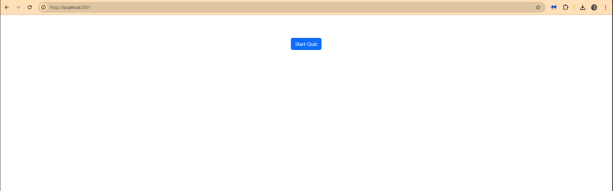

# Tech Quiz Test Suite

<p align="center">
  
</p>

Cypress component and end-to-end tests for a MERN tech quiz app (React, Express, MongoDB).



Walkthrough video: https://youtu.be/FcIQsPgJqd8

## What it does

- **Quiz app:** a React and TypeScript front end, an Express API (`GET /api/questions/random`) and MongoDB for the question set. Start the quiz, answer 10 questions, see the score, take a new quiz.
- **Component tests** (`cypress/component/Quiz.cy.jsx`): mount the `Quiz` component with the API intercepted and a fixture (`cypress/fixtures/questions.json`), so results are predictable.
- **End-to-end tests** (`cypress/e2e/quiz.cy.js`): drive the real app through the start screen, a full 10-question run, the "Quiz Completed" screen and the "Take New Quiz" restart.
- **Seed script:** loads the Python question set from `server/src/seeds/pythonQuestions.json` into MongoDB.

## Tech stack

| Area | Tools |
|---|---|
| Front end | React 18, TypeScript, Vite |
| Back end | Node.js, Express 4, Mongoose, MongoDB |
| Testing | Cypress 13 (component and e2e) |

## Run it

Needs Node.js and a MongoDB database (local or Atlas).

Create `server/.env` with:

- `MONGODB_URI` (required)
- `PORT` (optional, defaults to 3001)

```bash
npm install          # installs root, server and client dependencies
npm run build        # compiles the server (needed before seeding)
npm run seed         # loads the questions into MongoDB
npm run start:dev    # API and Vite dev server together
```

The production-style start is `npm start`, which builds the client and serves it from the API on port 3001.

## Test it

```bash
npm run cy:open                  # Cypress UI: pick component or e2e
npx cypress run --component      # component tests, headless
npx cypress run --e2e            # e2e tests, headless
```

The e2e tests expect the app to be running at http://localhost:3001 with the database seeded (use `npm start` in another terminal first). The component tests need no server.

## What I learned / built

- Mounting a React component in Cypress and stubbing the API with `cy.intercept` and a fixture, so tests do not depend on live data.
- Writing an end-to-end test for a full user flow, and where it gets slow: it uses fixed 2-second waits per question, which I would replace with waits on the API response.
- Wiring a TypeScript client, an Express API and Mongoose into one repo that builds and seeds from root-level npm scripts.
