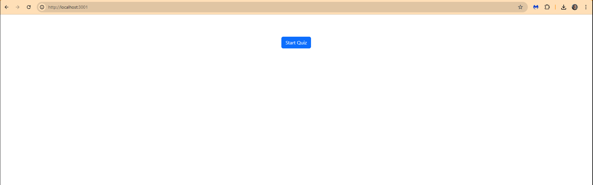

# 📋 Tech Quiz Test Suite

<p align="center">
  
</p>

> A polished Cypress test suite for the MERN‑stack Tech Quiz application—complete with both component and end‑to‑end coverage.  
> Ensures reliability by verifying quiz start, question flow, scoring, and restart functionality.

---

## 🔗 Links

- **GitHub Repo:** https://github.com/PHTMGatt/19-Testing-Tech-Quiz-Test-Suite
- **Walkthrough Video:** https://youtu.be/FcIQsPgJqd8 

---

## ✨ Project Overview

The Tech Quiz Test Suite adds comprehensive automated testing to an existing MERN‑stack quiz app:

- **Component Tests** validate individual UI pieces (button clicks, question rendering).  
- **End‑to‑End Tests** simulate real user flows—starting the quiz, answering 10 questions, viewing scores, and restarting.  
- **Fixtures** provide consistent mock data for predictable results.  
- **Single‑Command Run** (`npm run test`) executes all suites headlessly or in the Cypress UI.

---

## 🚀 Features

- ✅ Quiz Initialization  
- ✅ Question Navigation (next/previous)  
- ✅ Final Score Display  
- ✅ Quiz Restart Flow  
- ✅ Error Handling & Edge Cases  

---

## 🛠 Tech Stack

- **Framework:** React (with Jest for snapshots)  
- **Server:** Node.js, Express, MongoDB  
- **Testing:** Cypress (Component & E2E)  
- **CI:** npm scripts  

---

## 🎥 Demo

  
*A quick preview showing all tests passing in the Cypress Test Runner.*

---

## ⚙️ Usage

Once your quiz app is running, simply execute:

```bash
npm run test
